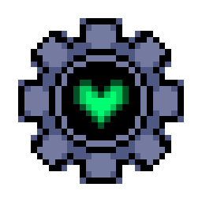

<h1>Deltamod</h1>

 

# About
Deltamod is an 1-click mod manager for select GameMaker-based games.

## Features
- Support for all Deltarune versions, UNDERTALE and Undertale Yellow.
- Has the option to copy your game's installation to a Deltamod folder and perform all operations, including backup, on that copy.
- Prepackaged mod format support (Deltamod modpack zip) to make installing mods easier. Developers can declare what to patch and what to override via an instruction set (modding.xml) and Deltamod will do the operations automatically, instead of leaving them to the user.
- Multiple mod support, powered by G3MTool. 
- Supports GameBanana 1-click protocol! With 1 click of a button on GameBanana, automatically download a mod.
- Also supports GameBanana's remote install protocol! When Deltamod is running on your main PC, query mods for download from any device with your GameBanana account on it!
- Browse GameBanana mods using the Mod Shop. Login to GameBanana directly via the app to like mods and leave comments.
- Login to GameBanana and Itch.io to manage collections!
- Supports integration with Steam.
- Tools to create modpacks are available as MiscTools (separate website)

## Compatibility
<h3>  Deltamod 2.X</h3>

Deltamod 2.X is the **currently supported version** of Deltamod which uses G3MTool for patching.  
Deltamod 2.X is currently available for **Windows and Linux**.   
macOS support is planned to be released.

<h3>  Deltamod 1.X</h3>

Deltamod 1.X is the **old version** of Deltamod which used GM3P (or other patchers) for patching. It is no longer supported.   
Deltamod 1.X was Windows only from 1.2 onwards, and Linux-compatible before 1.2.

# Running Deltamod from source
- Download Node.js [here](https://nodejs.org/en).
- Download the latest G3MTool release.
- Create a `tools` folder and add a `g3mtool` subfolder with G3MTool executables.
- Also create the appropriate `utmt/win` and `utmt/linux` subfolders with a release of UTMT CLI, depending on your OS.
- Run `npm i`.
- Now you can open your preferred command prompt and run `npm test` to run Deltamod.

 

# Building
Run `npm run build-windows` or `npm run build-linux` to package Deltamod as an installer and as unpacked files.

## OS support
(Note: while Deltamod and G3MTool run natively on Linux, the games don't - to boot up, Deltamod will need Wine so it can open .exe files)
|               | Windows       | Native Linux  | Native macOS | _macOS/Linux_ (w/ CrossOver or Wine) | _All OSes_ (w/ Windows emulation) |
| ------------- |:-------------:|:-----:|:--------:|:--------------:|:-----------------:|
| Officially released | ✅ | ✅ | ❌ | ❌ | ✅ |
| Tested by devs | ✅ | ✅ | ❌ | ❌ | ⚠️ Should work |
| Devs provide support | ✅ | ✅ | ❌ | ❌ | ✅ _(Specify if you are using emulation when reporting issues)_ |
| Usable | ✅ | ✅ [^1] | ❌ | ✅ | ✅ |
| DELTARUNE supports | ✅ | ✅ [^1] | ✅ | ✅ | ✅ |
| Autoupdating | ✅ | ❌ | ❌ | ✅ | ✅ |

[^1]: Most supported games run through Wine/Proton, a compatibility layer.
Even when an official Linux version doesn't exist, the Windows version running
through Wine is considered officially supported. For more compatibility info,
see [ProtonDB](https://www.protondb.com/), or for an short but interesting
read, see <https://blog.hiler.eu/win32-the-only-stable-abi/>.

## Licensing
The software is licensed under the EUPL 1.2. You can read the license [here](./LICENSE.txt).  
All rights are reserved on the Deltamod name and app icon, though. You may not advertise forks of the program using them - their use is subject to proper authorization, and may be revoked at any time by DELTAModders.  
Some assets in Deltamod are property of Toby Fox - if you're the copyright owner of these and would like to remove them from the program, feel free to email [ghinorhino@deltamodders.com](mailto:ghinorhino@deltamodders.com).
